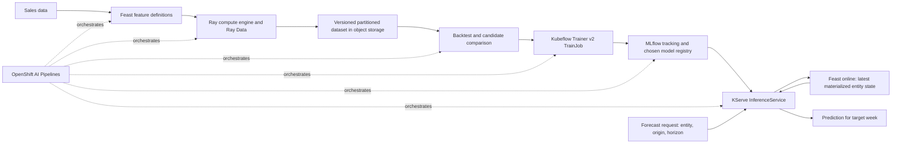

# Sales Demand Forecasting E2E Improvement Plan

**Status:** Implementation in progress. The leakage-safe feature contract and CPU-first profile are in the working tree. Phase 2 now has a static rolling-origin evaluator and MLflow report integration; it has not been run against Feast data in the demo namespace. No cluster resources have been applied.

## 1. Objective

Turn the current synthetic sales demo into a reproducible, leakage-free one-week-ahead forecasting workflow that demonstrates the OpenShift AI stack for the right jobs:

- Feast defines and serves the features.
- Ray distributes feature retrieval and data preparation when the data volume warrants it.
- Kubeflow Trainer v2 runs the selected model training job.
- OpenShift AI Pipelines coordinates the end-to-end workflow.
- MLflow records experiments and artifacts; one model registry is selected as the promotion authority.
- KServe serves a versioned artifact through a request that identifies the forecast being made.

The starting workload is synthetic: 104 weeks × 45 stores × 14 departments = 65,520 observations across 630 series. That is useful for demonstrating the interfaces, but it is not by itself evidence that distributed GPUs or this MLP are optimal.

## 2. Decisions and assumptions

1. **Forecast target:** one week ahead. For an origin week `t`, predict sales for `t + 1`. The contract must be revisited if the desired business horizon differs.
2. **Keep Ray in the demo:** the preferred path uses the Feast Ray backend and Ray Data for distributed retrieval/preparation. If that plugin cannot interoperate with the operator-managed Feast server, use the server-compatible Feast retrieval path in bounded chunks, write partitioned Parquet, and use Ray Data on KubeRay for downstream preparation. Record which path is active; do not describe the fallback as distributed Feast retrieval.
3. **Keep Kubeflow Trainer v2 for model training:** use `TrainJob`/`TrainerClient` for training. Do not also use Ray Train for the same training job. If Ray Train is later selected, it replaces Trainer as the training execution layer.
4. **Use CPU first for the default data size:** profile feature preparation and model training before reserving GPUs. Scale up the Ray cluster or Trainer resources only when measured runtime or memory requires it.
5. **Use declarative YAML for resources and SDKs for workflow actions:** YAML/CRs belong in GitOps for review and repeatability; SDKs belong in notebooks and pipeline components for feature access, job submission, tracking, and serving operations.
6. **Documentation baseline:** this plan references OpenShift AI Self-Managed 3.5 docs. Phase 0 must verify the actual cluster version, installed operators, CRDs, and supported Feast/Ray combination before implementation choices are finalized.
7. **Feast client baseline:** target upstream `feast==0.67.0` in a pinned application image. It was released on 2026-10-13 and requires Python 3.10 or newer. This is an upstream client target, not an assertion that Red Hat certifies that exact client/server combination. Treat it as a candidate until the Phase 0 compatibility gate proves it works with the operator-managed Feature Store server, the cluster's Python runtime, and the Ray/CodeFlare integration. Do not replace or rebuild operator-managed server images to force version parity. If the gate fails, retain the operator's known-compatible SDK/server combination and isolate 0.67.0 to a client workload only after that workload passes the same API checks.

## 3. Target workflow



The diagram shows the intended ownership, not a claim that all components are currently installed or available on the cluster. Feast online storage keeps the latest value per entity; it is not an arbitrary historical lookup by forecast origin. Serving must either require the request origin to match the latest materialized state or use a separately designed historical feature path.

## 4. Implementation phases

### Phase 0 — Verify the cluster and supported combinations

**Purpose:** confirm the platform prerequisites before changing manifests or choosing resource requests.

**Actions**

- Record OpenShift and OpenShift AI versions and the active `DataScienceCluster` configuration.
- Check the component states and APIs for Feature Store/Feast, distributed workloads (KubeRay and CodeFlare), Kueue, Kubeflow Trainer v2, AI Pipelines, MLflow, Model Registry, and KServe.
- Record available `ClusterTrainingRuntime` objects and verify that the selected runtime supports the intended training image and resource shape.
- Check NVIDIA/AMD GPU resource flavors, namespace queues/quotas, and current allocatable capacity. The demo configuration must not assume GPUs are available merely because a GPU resource name is present in YAML.
- Confirm a durable object-store endpoint and credentials for datasets and model artifacts. Confirm the storage mode and access path available to Workbench, Ray, Trainer, pipeline tasks, and KServe.
- Confirm whether the project needs RWX PVCs. Avoid requiring one shared PVC for every component if object storage can carry datasets and models.
- Verify the exact Red Hat-supported Feast/Ray package and image combination. RHOAI 3.5 documents Ray as a Feature Store compute engine, while upstream Feast labels its Ray offline store as a contributed plugin. Treat the exact combination as a compatibility gate, not an assumed guarantee.
- Build a compatibility matrix with one row per component: cluster/RHOAI version, operator version, CRD API version, managed Feast server image and digest, Python client version, Python version, Feast extras, Ray and CodeFlare SDK versions, Ray image, Trainer runtime and SDK, KFP SDK/IR version, MLflow/registry version, and KServe runtime. Record the source of each version and the smoke-check result. Keep client package versions separate from operator-managed image versions.
- Write down the project namespace, service accounts, TLS trust chain, network access, Secrets, and least-privilege permissions required by each workload.

**Read-only inventory commands** (run with the cluster administrator or project permissions needed to see each resource):

```bash
oc version
oc get datasciencecluster -A -o yaml
oc api-resources | grep -Ei 'feast|ray|trainjob|trainingruntime|datasciencepipelines|mlflow|inferenceservice|kueue'
oc get clustertrainingruntimes
oc get featurestores -A
oc get rayclusters -A
oc get inferenceservices -A
oc get datasciencepipelinesapplications -A
oc get clusterqueues,resourceflavors
oc get storageclass
oc describe nodes | grep -E '^Name:|nvidia.com/gpu|amd.com/gpu'
```

Run each API-specific `oc get` only when `oc api-resources` shows that resource on the cluster; an absent API is recorded as a missing prerequisite.

For the chosen project, also record the FeatureStore CR, relevant pod image references/digests, namespace quota/limits, PVCs, and object-store credentials/network paths available to each workload. Once each workload image exists, verify object-store access from the Workbench, Ray worker, pipeline task, Trainer pod, and serving pod. Missing CRDs are an inventory result, not a reason to create look-alike resources manually.

**Exit criteria**

- A committed `docs/cluster-compatibility-matrix.md` lists installed components, CRD/API versions, training runtimes, queue and GPU availability, storage endpoints, and supported package/image versions.
- A disposable namespace passes the Feast 0.67.0 core client checks against the operator-managed Feature Store: import/version check; authenticated `feast apply`; online read; materialization; historical retrieval; and TLS verification. These checks are required to claim Feast 0.67.0 support. The demo client pin is set to 0.67.0, but remains a candidate until this gate passes. Use a tiny checked-in fixture and record commands/results. If a core check fails, keep the operator's known-compatible client for that integration and mark Feast 0.67.0 support as blocked; do not claim support.
- Evaluate Ray integration separately. If `RetrievalJob.to_ray_dataset()` and the KubeRay connection pass, select the native Feast-Ray path. If they fail while Feast core checks pass, select the bounded-retrieval-to-Parquet fallback and prove Ray Data can read/process the output. Record versions and results; this optional plugin check must not block using Ray Data.
- The plan has an explicit fallback if a required operator, supported Ray integration, GPU, or storage capability is unavailable.

**Primary references:** [OpenShift AI distributed workload management](https://docs.redhat.com/en/documentation/red_hat_openshift_ai_self-managed/3.5/html/managing_openshift_ai/managing-distributed-workloads_managing-rhoai), [Feature Store setup](https://docs.redhat.com/en/documentation/red_hat_openshift_ai_self-managed/3.5/html/working_with_machine_learning_features/configuring_feature_store), [Feast SDK in RHOAI Workbenches](https://docs.redhat.com/en/documentation/red_hat_openshift_ai_self-managed/3.5/html/working_with_machine_learning_features/retrieving-features-for-model-training_featurestore), [Feature Store Ray compute engine](https://docs.redhat.com/en/documentation/red_hat_openshift_ai_self-managed/3.5/html/working_with_machine_learning_features/understanding-compute-engines-in-feature-store_featurestore), [Feast Ray offline store](https://docs.feast.dev/reference/offline-stores/ray), [Feast 0.67.0 release](https://github.com/feast-dev/feast/releases/tag/v0.67.0), [Feast 0.67.0 on PyPI](https://pypi.org/project/feast/0.67.0/).

### Phase 1 — Define the forecast contract and correct the feature timeline

**Purpose:** ensure training and inference solve the same future prediction task.

**Actions**

- Define a training row as `(store_id, dept_id, origin_week=t, horizon=1, target_week=t+1, target_sales=weekly_sales[t+1])`.
- Define an inference request that contains at least `store_id`, `dept_id`, `origin_week`, and `horizon`; return the target week with the prediction. A request for only store and department IDs does not specify which week is being forecast.
- Recompute lag features from sales available at or before the origin. Calculate rolling statistics over `weekly_sales.shift(1)` (or an equivalent strictly prior window), not over the row’s target value.
- Remove or redefine `sales_vs_avg`; the current calculation includes current-week sales and therefore exposes the label.
- Classify every covariate by when it is available. Calendar and holiday features can be known in advance; actual future temperature, fuel price, CPI, and unemployment are not valid future inputs unless the demo explicitly supplies forecasts available at the origin.
- Keep target columns separate from model inputs. Preserve a distinct Feast feature service for training/inference with the same feature names, types, and ordering, excluding the target.
- Use Feast historical retrieval for backtesting. At online inference, fetch the latest materialized state for `(store_id, dept_id)` and reject a stale/backdated origin unless the application has a separate historical feature store. Do not describe `get_online_features` as an as-of query.
- Decide whether the model is global across series or per-series/grouped. If a global model is used, expose suitable store/department identity or metadata to it; the current training code excludes both IDs, and department-specific behavior must not disappear from the feature contract.
- Handle missing history explicitly. Do not make a missing lag indistinguishable from a true zero without a documented policy; record warm-up rows and the resulting sample count.

**Likely code touch points:** [notebooks/01-feast-features.ipynb](../notebooks/01-feast-features.ipynb), [feature_repo/features.py](../feature_repo/features.py), [notebooks/02-training.ipynb](../notebooks/02-training.ipynb), [notebooks/03-inference.ipynb](../notebooks/03-inference.ipynb), and the current embedded training source in [manifests/06-trainjob.yaml](../manifests/06-trainjob.yaml).

**Reference:** [Feast online store behavior](https://docs.feast.dev/getting-started/components/online-store).

**Exit criteria**

- For every training example, all feature timestamps are at or before its forecast origin and the target timestamp is after it.
- No label or target-derived current-week statistic appears in the feature matrix.
- The same forecast request contract and feature names are used by the backtest and KServe inference path.
- A sample request makes the forecast origin, horizon, and returned target week unambiguous.

### Phase 2 — Establish model selection and evaluation

**Implementation status:** `scripts/evaluate_forecasts.py` is wired into `notebooks/02-training.ipynb`. It compares last-week naive, seasonal naive, and a pooled CPU histogram gradient-boosted tree; records fold/holdout and per-series metrics plus fit/runtime/resource details; and writes `rolling_origin_report.json` to the model directory and MLflow. The separate MLP run excludes the untouched holdout and is tagged `integration_candidate` with `selection_status=not_selected`. Notebook 03 only deploys it as an explicitly marked integration demo candidate. The code has only received static validation; the first cluster run must verify Feast column names/data coverage, actual runtime, and the model gates before any model is selected.

**Purpose:** select a model based on future performance rather than a fixed architecture or a leaked holdout score.

**Actions**

- Split on unique weekly timestamps, never a row index that can divide entities from the same week across train and validation. Assert that the maximum train date is strictly before the minimum validation date in each fold.
- Use expanding-window rolling-origin evaluation. Reserve the latest weeks for a final untouched evaluation and use multiple earlier origins for model comparison. Because there are only 104 weeks, document how many annual cycles each fold contains and avoid claiming robust annual generalization from two years of synthetic data.
- Make the initial split deterministic for the 104-week fixture: order weeks chronologically; compare candidates at every origin from week 64 through week 95 (each predicts the next week); hold out target weeks 97–104 for final evaluation (origins 96–103). The final holdout is eight consecutive one-week-ahead decisions with the origin advancing each week, not one eight-week-ahead forecast. Refit preprocessing inside each fold, and do not use holdout metrics to select or tune the model.
- Evaluate the following candidates on the same folds:
  - Last-week/naive forecast.
  - Seasonal-naive forecast using the prior-year observation where available.
  - A CPU pooled gradient-boosted tree over lag, rolling, calendar, store, and department inputs; encode store/department categoricals explicitly.
  - The current MLP as an optional neural candidate, with simpler widths and regularization tried only if it is competitive.
- Treat this as supervised forecasting-model training, not fine-tuning: the current data/model path has no pretrained weights to adapt. Add foundation-model fine-tuning only if a specific pretrained time-series model is selected, its license/runtime fit the cluster, and the same rolling-origin evaluation proves a benefit over these baselines.
- Use WAPE as the initial primary metric: `sum(abs(actual - prediction)) / sum(abs(actual))`. Report per-series and aggregate WAPE, MAE/RMSE, and signed weighted bias; do not rely on MAPE for low or zero sales. Proposed validation promotion gate: at least 2% relative improvement in mean fold WAPE over seasonal naive and absolute weighted bias `abs(sum(prediction - actual) / sum(abs(actual)))` no greater than 5%. After locking the candidate, require the final holdout to be no worse than seasonal naive on WAPE and to keep absolute weighted bias within 5%; if it fails, stop promotion and do not tune against that holdout. Keep thresholds configurable and label them demo defaults until a business owner supplies production thresholds. If seasonal naive is unavailable due to insufficient history, compare against last-week naive and state that limitation.
- Fit scalers, encoders, and any learned preprocessing on each fold’s training period only. Save the exact preprocessing with the selected model.
- Record each candidate, fold dates, feature version, dataset version, parameters, resource requests, metrics, and code/image version in MLflow.
- Select GPU or multi-node training only after timing the CPU baseline and the best candidate on representative data. The default 65,520-row dataset should not be treated as proof that a 2-node GPU job is beneficial.

**Exit criteria**

- One reproducible report compares candidates over identical time folds and includes per-series performance and resource/runtime observations.
- A model is promoted only if it passes the validation gate and the one-time untouched holdout gate without an unacceptable regression in bias or important series.
- The report includes split dates, row/series counts per fold, WAPE/MAE/RMSE/bias, and the gate result; a failed gate prevents model registration/deployment.
- If the MLP does not beat the baseline, the demo uses the winning model or labels the MLP as an integration example rather than the selected forecasting model.

### Phase 3 — Adopt operator-managed Feature Store and Ray resources

**Purpose:** use supported OpenShift AI reconciliation for platform services while preserving declarative, reviewable configuration.

**Actions**

- Enable the Feature Store component through the cluster’s `DataScienceCluster` configuration under the appropriate administrative GitOps path.
- Add a project-scoped `FeatureStore` CR. Configure the feature definitions/repository using an immutable Git reference where appropriate. Let the operator own the Feature Store server and UI lifecycle instead of hand-building equivalent Deployments, Services, Routes, and runtime package installation.
- Provision the online store, offline source, and registry backing systems separately. The Feature Store operator does not automatically create every backing database or object store. Configure credentials via Kubernetes Secrets or an approved secret provider, not a password embedded in a ConfigMap.
- Use Feast’s SDK/CLI for feature definitions, historical retrieval, and materialization. Keep business feature logic in the versioned Feast repository rather than duplicated in notebook and Job scripts. Run `feast apply` from a controlled feature-release job when the repository revision changes; do not make every model-training run mutate the feature registry.
- For the native Feast-Ray path, configure `offline_store.type: ray` and `batch_engine.type: ray.engine` with the validated KubeRay connection settings. If only the optional Ray plugin gate fails, keep the operator-supported Feast offline/batch engine and configure KubeRay for Ray Data instead.
- Split the current `.env.example` Feast settings into client dependencies and server facts. The demo client is pinned to `FEAST_CLIENT_VERSION=0.67.0`; the current legacy server manifest has a separate `FEAST_SERVER_VERSION=0.67.0` pin. The native-Ray candidate uses the `ray` extra and the same `RAY_VERSION` as the KubeRay image; Feast/Ray/CodeFlare compatibility gates remain open. The current `FEAST_IMAGE=${RAY_IMAGE}` still couples unrelated images and must be removed when the operator-managed FeatureStore path is adopted. Record image digests and the separately managed server image/digest in the compatibility matrix. Keep `RAY_IMAGE`/`RAY_VERSION` exclusively for Ray. Never template a custom server image from the Ray image variable or install packages at pod startup.
- Check the Feast version bundled in the standard Workbench image before upgrading it. If that SDK is different, keep the standard Workbench for platform-managed authentication or create a dedicated feature-preparation image; if a custom Workbench image is needed, build it from a supported RHOAI base and verify its Feature Store authentication and certificate behavior before documenting it as the user path.
- Keep the `RayCluster` as a native KubeRay CR managed by the operator. Use CodeFlare SDK and Kueue for supported workload lifecycle and quota/admission. Remove GPU requests from the Ray head and from feature-processing workers unless profiling proves they need accelerators.
- Keep the Ray dashboard internal and protected. Do not set `skip_tls: true` as the default demo path.

**Likely code touch points:** add a `FeatureStore` CR manifest; update [feature_repo/feature_store_ray.yaml](../feature_repo/feature_store_ray.yaml); revise [manifests/03-raycluster.yaml](../manifests/03-raycluster.yaml); retire the custom Feast server resources in [manifests/04b-feast-server.yaml](../manifests/04b-feast-server.yaml) only after the operator-managed path is verified. The current [RBAC manifest](../manifests/04a-feast-rbac.yaml) should be replaced or narrowed to the exact workload permissions and service accounts required.

**Exit criteria**

- Feature Store server and UI are reconciled by the Feature Store operator from a `FeatureStore` CR.
- The operator-managed Feature Store works with the selected backing stores and TLS configuration; the pinned client passes apply, online retrieval, historical retrieval, and materialization checks without replacing the server image.
- `feast apply` is a feature-definition release action and is not part of each normal training run.
- Ray access works through the approved authentication path; the dashboard is not exposed without authentication.
- No application ConfigMap contains a database password, and workloads do not rely on broad permissions granted to the namespace `default` service account.

### Phase 4 — Preserve distributed data through Ray Data

**Purpose:** demonstrate distributed preparation instead of only a distributed join followed by a driver bottleneck.

**Actions**

- Change the historical retrieval path so it does not immediately call `.to_df()` on the full result. On the native Feast-Ray path, use the validated `to_ray_dataset()` output. On the fallback path, retrieve bounded entity/time chunks, convert only each chunk, and write each chunk as a Parquet part; then read the parts with Ray Data. Neither path collects the full result in one driver DataFrame.
- Confirm the configured Feast Ray offline store's source restrictions before implementation: current upstream docs describe file sources for this backend. If the source is SQL or unsupported, export a versioned Parquet snapshot first, then use the Ray path against that snapshot.
- Use both Feast layers deliberately on the native path: the Feast Ray offline store handles supported file-source I/O, while `batch_engine.type: ray.engine` executes distributed feature retrieval/transforms; Ray Data then repartitions/writes training artifacts. On the compatibility fallback, the supported Feast engine writes bounded retrieval output and Ray Data handles downstream distributed preparation. Do not count only a KubeRay cluster existing as proof that Ray processed the data.
- If the operator-managed Feast server and the upstream Ray offline-store plugin cannot be used together at the required versions, keep Feast definitions/online serving on the operator-supported path, export historical results through bounded retrieval chunks to versioned Parquet, and use Ray Data on KubeRay for downstream distributed preparation. Document that fallback rather than claiming the Feast Ray plugin is vendor-supported.
- Persist a versioned dataset under a run-specific object-store URI. Include a manifest with schema, feature service/version, forecast contract, fold dates, source data version, row counts, and code/image digest.
- Partition/shard data so each Trainer rank can read its own training and validation data. Avoid saving identical full NumPy arrays for every rank on a shared PVC.
- Use a CPU Ray cluster for the current demo workload. Configure worker count and CPU/memory based on measurements. Use Kueue quota/admission for shared cluster capacity.
- Add generated scale profiles at 1x, 10x, and 100x the current row count (preserving series and weekly seasonality) to demonstrate when Ray improves throughput; show wall time, peak driver memory, worker count, and output row parity against a single-node path. The 1x profile remains the quick demo; larger profiles are opt-in.

**Decision boundary:** the preferred demo path uses Ray for Feast feature computation and Ray Data, with Kubeflow Trainer for model training. In the compatibility fallback, Feast retrieval uses the server-compatible path and Ray Data still performs distributed preparation. If the project later decides that Ray Train itself is the training feature to demonstrate, replace Trainer for that step rather than stacking two distributed training orchestrators on one model job.

**Exit criteria**

- Feature retrieval completes without a full-dataset conversion to Pandas on one driver.
- The saved output is reproducible, versioned, partitioned, and consumable by all training workers.
- A scale comparison shows when the Ray path is useful and confirms the CPU-only default does not reserve idle GPUs.

### Phase 5 — Consolidate training on Kubeflow Trainer v2

**Purpose:** keep a single authoritative training implementation and run it through the platform’s supported Trainer API.

**Actions**

- Extract the training function currently duplicated between the training notebook and [manifests/06-trainjob.yaml](../manifests/06-trainjob.yaml) into one versioned training package and immutable container image.
- Pin dependencies in the image build. Remove runtime `pip install` and mutable `@master` Git dependencies from job startup.
- Make the Trainer image consume the versioned Parquet dataset from object storage with `pyarrow`/the selected framework; do not install Feast or Ray there unless the training function actually calls their APIs. This keeps the Feast 0.67 compatibility surface in the feature-preparation image and avoids duplicating the distributed data-prep job inside Trainer.
- Use an installed `ClusterTrainingRuntime` where it matches the workload. Use the Kubeflow Trainer SDK (`TrainerClient`) for programmatic submission from a trusted workbench or pipeline component, or submit a declarative `TrainJob` CR from GitOps. Pick one canonical submission path per run; keep the other only as an intentional example, not a second implementation.
- Use CPU/single node as the first profile. Enable one GPU, DDP, and multi-node resources only when the benchmark shows a material improvement. Align the current separate `TRAINING_NUM_NODES` and `TRAINJOB_NUM_NODES` settings so there is one source of truth.
- Train each candidate on the phase 2 folds. For the winning model, refit only on the approved training window and preserve the exact feature schema and preprocessing artifact.
- Use a workload-specific service account and scoped Secret references. Do not pass a human Workbench token to a TrainJob, and keep TLS verification enabled.

**Exit criteria**

- The notebook, pipeline, and any direct TrainJob all execute the same training package/image.
- Runs record model family, data/fold version, image digest, feature schema, metrics, resource requests, and artifacts.
- The configured resource profile completes within the demo’s agreed runtime and does not reserve unused GPUs.

### Phase 6 — Orchestrate the E2E workflow with OpenShift AI Pipelines

**Purpose:** make the demo repeatable without manually executing unrelated notebooks and setup commands in the correct order.

**Pipeline stages**

1. Validate source schema, date coverage, duplicates, null policy, and forecast contract.
2. Resolve the immutable feature-repository revision and source-data snapshot; fail if either is mutable or absent. Feature definitions are applied by the separate release job, not by this training pipeline.
3. Submit the feature-preparation job using the validated Feast-Ray backend, or the documented bounded-chunk fallback; write the partitioned dataset and manifest to object storage and process it with Ray Data.
4. Run the fixed baselines and candidate models across the rolling origins in one CPU KFP task for the current dataset size; log fold metrics and a locked candidate configuration. Do not create one TrainJob per fold unless profiling shows this CPU stage is too slow.
5. Compare candidates with the validation promotion gate and stop on failure.
6. Submit one Kubeflow Trainer v2 TrainJob for the locked candidate, fit through target week 96, and pass the dataset URI plus a least-privilege service account.
7. Score the frozen week-96 model once on target weeks 97–104; stop promotion if the untouched holdout gate fails. Do not use those results to tune the candidate.
8. After the holdout gate passes, submit the deployment TrainJob using all labeled rows available through the data cutoff; log the resulting final artifact and provenance.
9. Register/promote through the chosen registry, then deploy/update the KServe `InferenceService` for that immutable model version.
10. Send a forecast request with entity, origin, horizon, and target week; verify freshness behavior, response schema, endpoint readiness, and record the result.

**Actions**

- Implement pipeline components with pinned container images and parameterized inputs; use the KFP SDK/DSL to compile and submit the pipeline.
- Define typed artifact contracts and record them in the pipeline source: `source_snapshot_uri`, `feature_repo_commit`, `feature_dataset_uri`, `feature_manifest_uri`, `cv_report_uri`, `locked_candidate`, `holdout_report_uri`, `model_uri`, and `inference_endpoint`. Pipeline parameters include the forecast horizon, split cutoff, object-store paths, Ray cluster/profile, and resource profile; credentials stay in Secrets/connections and service accounts.
- Configure the `DataSciencePipelinesApplication` and MLflow integration for pipeline-run tracking where available. Pass explicit, least-privilege configuration into child TrainJobs; do not assume variables injected into a pipeline task automatically reach a separately created training pod.
- Keep interactive notebooks as an exploration and launch surface. They must call the same feature/training/pipeline packages rather than carry separate copies of core logic.
- Compile the KFP v2 pipeline to IR YAML in CI, validate it against the cluster's installed pipeline version, then submit it using the configured S3-compatible artifact store. Pin KFP SDK and component images; do not rely on a developer notebook's mutable Python environment.
- Define cleanup as a separate, explicit pipeline or documented command. Do not delete persistent datasets, model versions, or user-owned PVC data as part of the default successful run.

**Exit criteria**

- One pipeline run can go from data validation through an endpoint prediction without hand-editing resources between stages.
- Failed stages stop downstream promotion/deployment and preserve diagnostic logs and artifacts.
- A user can rerun the same code/image/data versions and see equivalent fold results.

### Phase 7 — Standardize tracking, registry, and serving

**Purpose:** create a traceable path from evaluated candidate to inference endpoint.

**Actions**

- Enable the RHOAI-managed MLflow Operator through `DataScienceCluster`, then configure its single cluster-scoped `MLflow` CR named `mlflow` in `redhat-ods-applications` with a PostgreSQL metadata backend and S3-compatible artifacts using Secret references. Do not deploy a parallel hand-built MLflow server. In the demo project, create the required `MLflowConfig` named `mlflow` and the `mlflow-artifact-connection` secret when using project-specific S3 storage. With that per-project override, pipeline and training clients access S3 directly, so provide scoped credentials to each client that logs or reads artifacts. If direct S3 credentials in clients are undesirable, use the global MLflow artifact proxy configuration instead. MinIO can back the demo bucket if clearly labeled as demo-only; use the platform's approved object store for production.
- Use the RHOAI-managed MLflow Model Registry as the demo's canonical promotion record when the installed MLflow version exposes it. Do not deploy a second registry for the same model. If the cluster requires OpenShift AI Model Registry instead, select it before implementation and record one-way promotion ownership; do not keep two competing model-version authorities.
- Pin an MLflow SDK version that matches the installed RHOAI MLflow server. Bind pipeline and training service accounts to the documented namespace-scoped `mlflow-integration` role for API access; use the platform's Kubernetes-namespaced authentication instead of copying a Workbench user's token into a TrainJob.
- Store model weights, preprocessing, feature names/types, forecast horizon, model family, training cutoff, code/image digest, and evaluation report as a versioned artifact.
- Keep KServe `InferenceService` as the serving abstraction. Use the KServe SDK for notebook-driven interaction or CR YAML for GitOps, but have both refer to the same immutable model artifact and runtime.
- Build and pin the serving image before deployment. Remove package installation from pod startup and avoid depending on a shared model PVC where an object-store model URI is supported.
- Update the V2 inference contract to include `store_id`, `dept_id`, `origin_week`, and `horizon`; return the predicted amount and target week. Fetch the latest materialized online state and create known-future calendar features consistently with training.
- Define stale-origin behavior explicitly: the demo accepts only the latest materialized origin for each entity. A request for an earlier origin returns a clear validation error unless a separate historical-serving path is implemented and evaluated. Do not imply Feast online storage retains a time series of historical values.

**Exit criteria**

- The served model version maps to a recorded evaluation and immutable artifact.
- The MLflow project workspace, tracking API, registry API, and S3 artifact path work from both a pipeline task and the Trainer-created pod under their workload identities.
- KServe readiness and inference work after deployment/restart without relying on a Workbench filesystem.
- A prediction response identifies the forecasted week and model version.

**Primary references:** [RHOAI MLflow installation and configuration](https://docs.redhat.com/en/documentation/red_hat_openshift_ai_self-managed/3.5/html/working_with_mlflow/installing-mlflow_mlflow), [RHOAI MLflow SDK authentication and project artifact storage](https://docs.redhat.com/en/documentation/red_hat_openshift_ai_self-managed/3.5/html/working_with_mlflow/installing-and-authenticating-mlflow-sdk_mlflow), [MLflow tracking from AI Pipelines](https://docs.redhat.com/en/documentation/red_hat_openshift_ai_self-managed/3.5/html/working_with_ai_pipelines/tracking-pipeline-experiments-with-mlflow_ai-pipelines).

### Phase 8 — Secure and document the demo path

**Actions**

- Keep `.env` for local, non-secret configuration only. Use Kubernetes Secrets or the organization’s approved secret provider for credentials. Avoid placing generated `.env` files on shared volumes accessible to all pods.
- Put non-secret demo parameters in `.env.example` and validate them in `scripts/render_config.py`: namespace, service endpoints, storage class/size, `FORECAST_HORIZON_WEEKS=1`, `RAY_SCALE_PROFILE=1x|10x|100x`, `PROMOTION_MIN_RELATIVE_WAPE_GAIN=0.02`, `MAX_ABS_WEIGHTED_BIAS=0.05`, and the CPU/GPU resource profile. Keep dependency versions in image lockfiles and credentials in Kubernetes Secrets; `.env` must not become a replacement for either.
- Replace plain-text credentials in ConfigMaps; rotate any credentials that may have been used outside a local demo.
- Remove insecure TLS flags and use trusted certificates for Feast, Ray, MLflow, and KServe. Do not expose the Ray dashboard publicly for routine use.
- Bind each workload to its own service account with only required verbs/resources. Remove the `default` service-account Ray mutation binding unless a reviewed requirement proves it necessary.
- Publish the exact prerequisites, component states, storage requirements, queue/GPU needs, pipeline launch command, expected outputs, and cleanup steps in the README.
- Retire the old hand-built Feast server, duplicated TrainJob script, and manual setup instructions only after the replacement workflow passes the acceptance gates.

## 5. End-to-end acceptance gates

The demo is ready to call an E2E forecasting example when all of the following hold:

- **Forecast validity:** all features are available at or before the origin; target is strictly in the future; the same horizon and feature contract apply in training and serving.
- **Evaluation validity:** train and validation dates do not overlap; multiple rolling origins are reported; baseline comparison is visible; the selected model meets the agreed metric/bias gate.
- **Ray validity:** Ray Data processes the partitioned feature dataset; the full result is not collected to a single driver; Ray resources and elapsed time are recorded; no idle GPU is reserved by default. Claim distributed Feast retrieval only when the native Feast-Ray gate passed.
- **Feast compatibility:** the dedicated feature-preparation image reports Feast 0.67.0 and its locked Python/dependency versions; any Workbench that directly calls Feast records its own SDK version and passes the same client/server checks; the operator-managed server image/version is recorded separately; TLS checks pass. Require Ray dataset conversion only for the native Feast-Ray path.
- **Platform validity:** Feature Store, MLflow, KubeRay/Ray, Trainer, Pipelines, and KServe resources use the enabled operators/APIs supported by the actual cluster version.
- **Reproducibility:** data, features, code, images, model, and metrics have versioned identifiers and are stored durably.
- **Serving validity:** the KServe endpoint loads the promoted artifact and accepts a forecast request with an explicit origin/horizon.
- **Security validity:** no secrets are stored in ConfigMaps or shared `.env` files; TLS verification is enabled; workload identities are least privilege.
- **Usability:** the README describes prerequisites, one-command/one-pipeline launch, expected artifacts, and cleanup without relying on undocumented manual console edits.

## 6. Repository areas expected to change

This plan does not make these changes yet. Expected work areas are:

- Feature semantics: `notebooks/01-feast-features.ipynb`, `feature_repo/features.py`, and Feast config under `feature_repo/`.
- Training and evaluation: `notebooks/02-training.ipynb`, `manifests/06-trainjob.yaml`, and a single extracted training package/container build.
- Ray lifecycle and data path: `manifests/03-raycluster.yaml`, `manifests/05-dataprep-job.yaml`, and the historical retrieval/output implementation.
- Platform services: `manifests/04a-feast-rbac.yaml`, `manifests/04b-feast-server.yaml`, and operator CR manifests. Use the already-managed RHOAI MLflow instance; do not deploy a parallel MLflow server or local artifact store by default.
- Pipeline/serving: AI Pipelines definitions, `notebooks/03-inference.ipynb`, and `manifests/08-kserve-inference.yaml`.
- User path: `.env.example`, `scripts/render_config.py`, `manifests/kustomization.yaml`, and `README.md`.

The current worktree already has user changes in several of these files. Implementation should preserve and review those changes rather than reset or replace them.

## 7. Recommended delivery order

1. **Compatibility record:** complete Phase 0; commit the cluster/version matrix and the Feast 0.67.0 compatibility result before changing runtime images.
2. **Forecast correctness:** implement Phases 1–2; merge only after the fixed time split, no-leakage assertions, candidate report, and promotion gate are reproducible.
3. **Feature/data path:** implement Phase 3–4; merge the FeatureStore CR, secrets, Ray configuration, and object-store partitioned output after the operator and Ray checks pass.
4. **Single training package:** implement Phase 5; merge the pinned CPU Trainer image and TrainJob submission path after the same package runs in the notebook and Trainer.
5. **Orchestration:** implement Phase 6; compile and validate the pipeline definition, then prove one run reaches a registered model with failure-gated promotion.
6. **Serving and docs:** implement Phases 7–8; merge immutable artifact serving, endpoint smoke request, cleanup, and README runbook.

Do not spend the first implementation cycle tuning the MLP or increasing GPU count. A clean forecast contract and leakage-free backtest are prerequisites for those choices.

## 8. First implementation PR checklist

The first coding PR should be deliberately small and unblock the rest of the work:

1. Add the Phase 0 compatibility matrix template and fill in the observed cluster/operator versions.
2. Build a disposable Feast 0.67.0 client image using Python 3.10+ and a fully locked dependency set; leave operator-managed images unchanged.
3. Run and record Feast core client checks separately from the native Ray plugin checks. If Feast 0.67.0 core checks fail, keep the known-compatible client and mark 0.67.0 support blocked. If only the native Ray plugin checks fail, use the bounded-Parquet/Ray Data path.
4. Add a `make`/script entrypoint that prints the client/server/Ray version matrix and runs the small feature retrieval smoke path without launching model training.
5. Update `.env.example` only after the image and smoke path are green; keep secrets out of `.env.example` and `.env`.

The following PR should implement the deterministic forecast contract and evaluation protocol. This order makes the Feast upgrade a verified dependency decision before it is copied into every notebook and job manifest.
